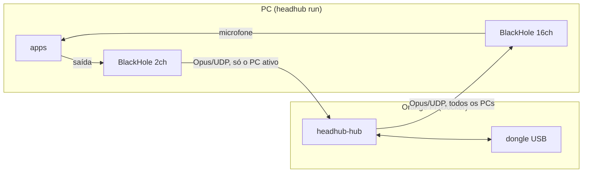

# head-hub

Um headset USB compartilhado entre vários PCs. O Orange Pi fica com o dongle; o PC ativo manda o áudio para o headset e todos os PCs recebem o microfone. Requisitos em [docs/PRD.md](docs/PRD.md).



Protocolo: UDP na porta 7700, Opus mono 48 kHz em frames de 10 ms, heartbeat a cada 1 s. Sem sessão: o cliente e o hub se reconectam sozinhos. O tráfego **não é criptografado**; use só na LAN.

## Início rápido

```sh
scripts/deploy-server.sh                       # 1. sobe o hub no Orange Pi e mostra o token
scripts/install-macos.sh --hub 192.168.18.100 --token <token>   # 2. em cada Mac
```

## Estrutura

| Caminho | Conteúdo |
| --- | --- |
| `crates/core` | Protocolo, Opus, captura/reprodução (cpal), buffer de jitter |
| `crates/hub` | Servidor (binário `headhub-hub`) |
| `crates/client` | Cliente (CLI `headhub`). `ports.rs` define `VirtualCable` e `Autostart`; `adapters/` tem um adapter por SO: `macos.rs` (BlackHole + launchd) e `linux.rs` (PulseAudio/PipeWire + systemd) |
| `server/` | `Dockerfile`, `compose.yaml` e `.env.example` do hub |
| `scripts/deploy-server.sh` | Gera a imagem arm64 e publica no servidor por SSH |
| `scripts/install-macos.sh` | Instala e configura o cliente no macOS |
| `docs/PRD.md` | Requisitos |

Para adicionar Windows, crie `adapters/windows.rs` implementando os dois traits e registre em `adapters/mod.rs`.

## Servidor (Orange Pi)

Requisitos: Docker na máquina local (para gerar a imagem) e Docker com Compose no servidor.

```sh
scripts/deploy-server.sh [usuario@host]        # padrão: orangepi@192.168.18.100
```

O script:
1. cria `server/.env` com um token aleatório, se ainda não existir;
2. instala sua chave SSH no servidor, se preciso (pede a senha uma vez);
3. gera a imagem `headhub-hub` para linux/arm64, envia e reinicia o container em `~/head-hub`;
4. mostra o comando de instalação dos clientes, com o token.

Rode de novo para publicar uma versão nova. Os PCs se reconectam sozinhos em cerca de 1 s.

Em `server/.env`, `HEADHUB_DEVICE` é um trecho do nome ALSA do headset (hoje `G435`). Para ver os nomes, no servidor:

```sh
cd ~/head-hub && docker compose run --rm --no-deps hub --device '?'   # o erro lista os dispositivos
```

O container usa `restart: always` e tenta de novo até o headset aparecer. O PC ativo fica salvo em `~/head-hub/data/active`.

O volume de saída do headset é o controle `PCM` do ALSA no servidor (`amixer -c Headset sset PCM 100%`; salve com `sudo alsactl store`).

### Métricas

A cada 10 s o hub registra a saúde do áudio do PC ativo (`docker compose logs -f`), e cada cliente registra a do microfone no próprio log:

```text
áudio de 192.168.18.195:55619: 1000 pacotes, perda 0.0%, atrasados 0, pico 0.81, buffer 20 ms
```

`pico` 0.00 significa silêncio (microfone mudo, por exemplo). `buffer` é o atraso do buffer de jitter, mantido perto de 20 ms com correção gradual da diferença de clock.

## Cliente macOS

Precisa de uma cópia deste repositório no Mac.

```sh
scripts/install-macos.sh --hub 192.168.18.100 --token <token> [--name nome-do-pc]
```

O script instala o que faltar (Homebrew, Rust, BlackHole 2ch e 16ch, SwitchAudioSource, cmake) e compila o `headhub` em `~/.cargo/bin`. Depois ele:
- define **BlackHole 2ch** como saída e **BlackHole 16ch** como microfone padrão do sistema;
- salva `~/.config/headhub/config.toml` e registra o LaunchAgent que roda o agente no login;
- espera o agente conectar e passa o headset para este Mac.

Rode de novo para atualizar. O instalador do BlackHole pede a senha de administrador; se o macOS pedir acesso à Rede Local ou ao Microfone para o `headhub`, permita.

Log: `~/Library/Logs/headhub.log`. A cada binário novo, o macOS bloqueia a rede do primeiro processo; o agente sai após 15 s sem resposta do hub e o launchd o reinicia já liberado.

| Comando | Faz |
| --- | --- |
| `headhub activate [nome]` | Passa o headset para este PC, ou para o PC informado |
| `headhub status` | Mostra o PC ativo e os conectados |
| `headhub uninstall` | Remove o início automático (depois escolha outra saída/entrada em Ajustes > Som) |

Para trocar por atalho, crie no app Atalhos um atalho "Executar script de shell" com `~/.cargo/bin/headhub activate` e associe uma tecla a ele.

## Cliente Linux

Precisa de PulseAudio ou PipeWire com `pipewire-pulse`, e do `pactl` (pacote `pulseaudio-utils`). Para compilar: `cmake`, `pkg-config` e `libasound2-dev`.

```sh
cargo install --path crates/client
headhub setup --hub 192.168.18.100 --token <token>
```

`setup` cria os dispositivos virtuais e instala o serviço de usuário `headhub.service` no systemd (log: `journalctl --user -u headhub -f`). Os dispositivos são recriados a cada início do agente, porque somem quando o servidor de som reinicia.

Nos apps, use **headhub-speaker** como saída e **headhub-mic** como microfone. Para trocar por atalho, associe `~/.cargo/bin/headhub activate` a uma tecla nas configurações de atalhos do ambiente gráfico.
